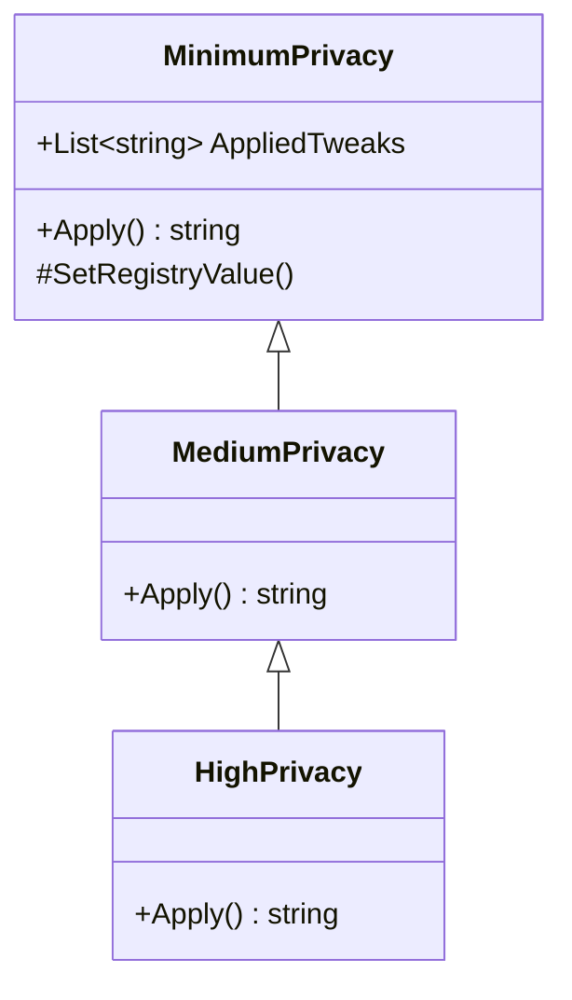

<div align="center">

# CrossOptimizer

### Утиліта для мінімізації телеметрії та налаштування Windows

<br/>


<br/>

[Можливості](#-можливості) •
[Що змінюється](#-що-саме-змінюється) •
[Що нового](#-що-нового) •
[API](#-api) •
[Запуск](#-запуск) •
[Безпека](#-безпека)

</div>

---

## 📌 Про проєкт

**CrossOptimizer** вимикає телеметрію Windows, відключає непотрібні служби, видаляє встановлені програми та очищає тимчасові файли. Інтерфейс мінімалістичний, у темній темі, побудований на **Avalonia**. Уся логіка винесена в окремий **API**, який можна використовувати і без інтерфейсу.

Усі зміни прозорі: список параметрів реєстру та служб зашитий у коді й доступний у вікні **«Специфікація змін»**. Якщо щось пішло не так, зміни можна відкотити через точку відновлення Windows.

> [!WARNING]
> Програма змінює реєстр і служби Windows. Перед застосуванням перегляньте розділ [Що саме змінюється](#-що-саме-змінюється).

---

## ✨ Можливості

| | Розділ | Що робить |
|:-:|---|---|
| 🔒 | **Приватність (реєстр)** | Три профілі: Min, Med, Max. Кожен наступний включає попередній |
| ↩️ | **Точка відновлення** | Автоматичне створення (не частіше одного разу на день) і відкат змін |
| ⚙️ | **Служби** | Вибіркове вимкнення зі списку, є пошук |
| 🗑️ | **Видалення програм** | Список встановлених програм із пошуком, видалення вибраних |
| 📄 | **Специфікація змін** | Повний перелік параметрів реєстру та служб, які може змінити програма |
| 🧹 | **Очищення** | Local TEMP і Global TEMP |
| 📊 | **Статистика сесії** | Видалені файли й папки, програми, служби, застосовані твіки |
| 🚀 | **Швидкий запуск (Admin)** | CMD, PowerShell, Explorer, Task Manager, Regedit, Services |
| 🔐 | **Блокування UI** | Захист від випадкових натискань |

---

## 🔍 Що саме змінюється

### Приватність

Профілі накопичуються: **Med** включає **Min**, а **Max** включає **Med**.

<details>
<summary><b>🟢 Min: 4 параметри</b></summary>

<br/>

| Що вимикається | Ключ | Параметр | Значення |
|---|---|---|:-:|
| Збір телеметрії | `HKLM\SOFTWARE\Policies\Microsoft\Windows\DataCollection` | `AllowTelemetry` | `0` |
| Персоналізація | `HKCU\Software\Microsoft\Windows\CurrentVersion\Privacy` | `TailoredExperiencesWithDiagnosticDataEnabled` | `0` |
| Рекламний ID | `HKCU\Software\Microsoft\Windows\CurrentVersion\AdvertisingInfo` | `Enabled` | `0` |
| Спонсорські пропозиції | `HKLM\SOFTWARE\Policies\Microsoft\Windows\CloudContent` | `DisableWindowsConsumerFeatures` | `1` |

</details>

<details>
<summary><b>🟡 Med: ще 6 параметрів</b></summary>

<br/>

| Що вимикається | Ключ | Параметр | Значення |
|---|---|---|:-:|
| Звіти про помилки | `HKLM\SOFTWARE\Policies\Microsoft\PCHealth\ErrorReporting` | `DoReport` | `0` |
| Автоматичне встановлення оновлень | `HKLM\SOFTWARE\Microsoft\Windows\CurrentVersion\WindowsUpdate\Auto Update` | `AUOptions` | `2` |
| Збір даних про встановлене ПЗ | `HKLM\SOFTWARE\Policies\Microsoft\Windows\AppCompat` | `DisableInventory` | `1` |
| Відстеження запусків програм | `HKCU\Software\Microsoft\Windows\CurrentVersion\Explorer\Advanced` | `Start_TrackProgs` | `0` |
| Історія пошуку | `HKCU\Software\Microsoft\Windows\CurrentVersion\Search` | `SearchHistoryEnabled` | `0` |
| Публікація активностей | `HKLM\SOFTWARE\Policies\Microsoft\Windows\System` | `PublishUserActivities` | `0` |

</details>

<details>
<summary><b>🔴 Max: ще 8 параметрів</b></summary>

<br/>

| Що вимикається | Ключ | Параметр | Значення |
|---|---|---|:-:|
| Cortana | `HKLM\SOFTWARE\Policies\Microsoft\Windows\Windows Search` | `AllowCortana` | `0` |
| Стрічка активності | `HKLM\SOFTWARE\Policies\Microsoft\Windows\System` | `EnableActivityFeed` | `0` |
| Геолокація | `HKLM\SOFTWARE\Policies\Microsoft\Windows\LocationAndSensors` | `DisableLocation` | `1` |
| Аналіз тексту | `HKCU\Software\Microsoft\InputPersonalization` | `RestrictImplicitTextCollection` | `1` |
| Аналіз рукописного вводу | `HKCU\Software\Microsoft\InputPersonalization` | `RestrictImplicitInkCollection` | `1` |
| Запити на відгуки | `HKLM\SOFTWARE\Policies\Microsoft\Windows\DataCollection` | `DoNotShowFeedbackNotifications` | `1` |
| Біометричні датчики | `HKLM\SOFTWARE\Policies\Microsoft\Biometrics` | `Enabled` | `0` |
| Хмарна синхронізація налаштувань | `HKLM\SOFTWARE\Policies\Microsoft\Windows\SettingSync` | `DisableSettingSync` | `2` |

</details>

### Служби

<details>
<summary><b>⚙️ Список служб (Start = 4, вимкнено)</b></summary>

<br/>

| Служба | Призначення |
|---|---|
| `DiagTrack` | Телеметрія та діагностика |
| `dmwappushservice` | Маршрутизація WAP Push-повідомлень |
| `WerSvc` | Звіти про помилки Windows |
| `XblAuthManager` | Xbox Live: авторизація |
| `XblGameSave` | Xbox Live: хмарні збереження |
| `XboxNetApiSvc` | Xbox Live: мережеві сервіси |
| `PhoneSvc` | Телефонна служба |

Список фіксований у коді: програма не може вимкнути жодну службу поза цим переліком.

</details>

### Видалення програм

Програма шукає встановлені застосунки в реєстрі й запускає їхній штатний деінсталятор. Без обхідних шляхів: якщо деінсталятор не спрацював, програма залишиться в системі.

> [!CAUTION]
> - **Біометрія** (рівень Max): вимикає Windows Hello (відбиток пальця, розпізнавання обличчя).
> - **Xbox-служби**: якщо ви користуєтеся Xbox App або Game Pass, їх не вимикайте.

---

## 🆕 Що нового

Ця версія базується на попередній утиліті, але має іншу архітектуру.

- **Додано API.** У попередній версії його не було взагалі: уся логіка була прив'язана до інтерфейсу.
- **Чистіший код.** Профілі приватності реалізовані як ланцюжок наслідування, нові параметри додаються в одному місці.
- **Мінімалістичний інтерфейс на Avalonia.** Менше елементів, чіткі розділи, темна тема.
- **Фіксований перелік служб.** Відключити щось зайве неможливо.
- **Видалення штатними засобами.** Без сторонніх утиліт і обходів.

---

## 🔌 API

Логіка винесена в окрему збірку `CrossOptimizerAPI`, яку використовує Avalonia-інтерфейс.

| Простір імен | Клас | Призначення |
|---|---|---|
| `CrossOptimizerAPI.ServiceController` | `MinimumPrivacy` | Базовий рівень приватності, запис у реєстр |
| `CrossOptimizerAPI.ServiceController` | `MediumPrivacy` | Розширює `MinimumPrivacy` |
| `CrossOptimizerAPI.ServiceController` | `HighPrivacy` | Розширює `MediumPrivacy` |
| `CrossOptimizerAPI.Security` | `AutoRestorePoint` | Створення точки відновлення |
| `CrossOptimizerAPI.Security` | `QuickLaunch` | Запуск системних утиліт від імені адміністратора |

### Профілі приватності



`Apply()` повертає текстовий статус. Властивість `AppliedTweaks` містить описи лише тих параметрів, які вдалося записати в реєстр.

```csharp
using CrossOptimizerAPI.ServiceController;

var privacy = new MediumPrivacy();

string status = privacy.Apply();
Console.WriteLine(status);

foreach (string tweak in privacy.AppliedTweaks)
{
    Console.WriteLine($"• {tweak}");
}
```

### Точка відновлення

`AutoRestorePoint.CreateOnStartupAsync(bool force = false)` створює точку відновлення через PowerShell (`Checkpoint-Computer`, тип `MODIFY_SETTINGS`). Дата останньої точки зберігається в `HKCU\Software\CrossOptimizer`, тому без `force` метод створює її не частіше одного разу на день.

```csharp
using CrossOptimizerAPI.Security;

var restore = new AutoRestorePoint();

string result = await restore.CreateOnStartupAsync();
string forced = await restore.CreateOnStartupAsync(force: true);
```

### Швидкий запуск

`QuickLaunch` запускає системні утиліти з підвищенням прав (`runas`).

| Метод | Запускає |
|---|---|
| `OpenExplorer()` | `explorer.exe` (диск `C:\`) |
| `OpenCmd()` | `cmd.exe` |
| `OpenPowerShell()` | `powershell.exe` |
| `OpenTaskMgr()` | `taskmgr.exe` |
| `OpenRegedit()` | `regedit.exe` |
| `OpenServices()` | `services.msc` |
| `OpenRestore()` | `rstrui.exe` (відновлення системи) |
| `RunAdmin(fileName, arguments)` | Будь-який файл від імені адміністратора |

```csharp
using CrossOptimizerAPI.Security;

var launcher = new QuickLaunch();

launcher.OpenTaskMgr();
launcher.RunAdmin("notepad.exe", "C:\\test.txt");
```

---

## 🚀 Запуск

1. 📥 Завантажте останній реліз зі сторінки [Releases](../../releases).
2. ▶️ Запустіть `CrossOptimizer.exe` **від імені адміністратора**.
3. 📄 Відкрийте **«Специфікація змін»** і перегляньте, що буде змінено.
4. 🔒 Оберіть профіль приватності: **Min**, **Med** або **Max**.
5. ⚙️ За потреби вимкніть служби або видаліть програми зі списків.
6. ↩️ Якщо щось пішло не так, натисніть **«Відкотити зміни (Точка відновлення)»**.

### Збірка з вихідного коду

```bash
git clone <URL-репозиторію>
cd <папка-проєкту>
dotnet build -c Release
```

Для збірки потрібен [.NET SDK 10](https://dotnet.microsoft.com/download).

---

## 🛡️ Безпека

- 🔍 Усі параметри реєстру і служб відомі заздалегідь і видимі у вікні специфікації.
- ↩️ Зміни можна відкотити через точку відновлення Windows.
- 🔐 Для запису в реєстр і створення точки відновлення потрібні права адміністратора.
- 🧪 Рекомендуємо спершу випробувати програму на віртуальній машині.

---

<div align="center">

⭐ Якщо проєкт був корисним, поставте зірку на GitHub

</div>
